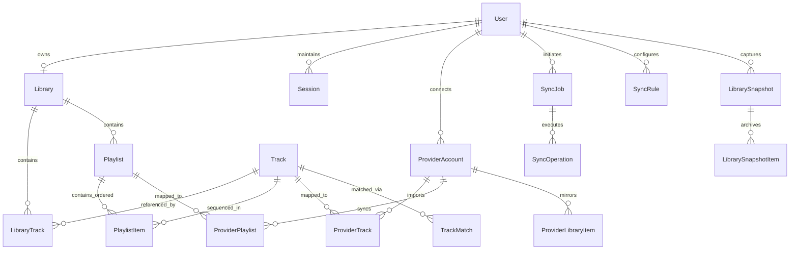

# SONORA Canonical Domain Model & Data Ownership Specification

**Phase:** Phase 2 --- Canonical Library and Provider Foundations  
**Status:** Approved Architecture Baseline  
**Document version:** 1.0.0  

---

## 1. Executive Summary & Core Invariants

SONORA is a provider-independent music library, catalog, and portability platform. Its fundamental invariant is that **SONORA's canonical library is strictly decoupled from external streaming providers** (Spotify, Apple Music, YouTube Music, etc.).

### Invariant Rules
1. **Provider IDs are Never Primary Keys**: Canonical entities (`Track`, `Album`, `Artist`, `Playlist`, `Library`) utilize system-generated UUIDs (v4). External provider IDs (e.g. Spotify URI `spotify:track:4cOdK2wGLETKBW3PvgPWqT`, Apple Music Store ID `1440857781`, YouTube video ID `kJQP7kiw5Fk`) are stored exclusively in dedicated mapping tables (`ProviderTrack`, `ProviderPlaylist`, `ProviderLibraryItem`).
2. **Canonical State vs. Provider State**:
   - **Canonical Library (`LibraryTrack`)**: Represents the user's sovereign, provider-agnostic collection (e.g. "My saved tracks").
   - **Provider Library (`ProviderLibraryItem`)**: Represents an external snapshot of what is currently saved or liked inside a specific connected provider account.
   - A track may exist in a user's canonical library without being saved in Spotify, or saved in Spotify without yet being imported into the canonical library.
3. **Playlist Order & Duplicate Preservation**:
   - A playlist is an ordered sequence of entries.
   - Songs may occur multiple times in the same playlist (e.g., reprise, DJ set tracklist, conceptual album loops).
   - Each playlist entry has its own independent identifier (`PlaylistItem.id`), an explicit integer sequence number (`position`), and a foreign key to the canonical track (`trackId`).
   - Deduplication MUST NOT collapse repeated playlist occurrences unless explicitly requested by the user during an export or maintenance action.
4. **Data Ownership & Multi-Tenant Isolation**:
   - Every user-scoped resource (`Library`, `LibraryTrack`, `Playlist`, `PlaylistItem`, `ProviderAccount`, `SyncJob`, `LibrarySnapshot`) belongs to a `userId`.
   - Cross-user queries are strictly rejected at the repository/service layer and scoped via composite foreign keys and tenant filtering.
5. **Soft Deletions & Tombstones**:
   - Canonical playlists and tracks support soft deletion (`deletedAt`) to preserve auditability and prevent destructive sync cascades.
   - Removed provider items are tracked via tombstone records (`status: REMOVED`) rather than hard physical deletion when sync reconciliation is active.

---

## 2. Entity-Relationship Architecture

---

## 3. Data Dictionary

### 3.1. Identity & Accounts
- **`User`**: The sovereign human account.
  - `id`: UUID (Primary Key).
  - `email`: String (Unique).
  - `displayName`: String (Nullable).
  - `passwordHash`: String (Nullable, reserved for future local auth).
  - `createdAt`, `updatedAt`: Timestamps (UTC).
- **`ProviderAccount`**: A user's linked connection to an external music streaming provider.
  - `id`: UUID (Primary Key).
  - `userId`: UUID (Foreign Key -> `User.id`, Cascade).
  - `provider`: Enum (`SPOTIFY`, `APPLE_MUSIC`, `YOUTUBE_MUSIC`).
  - `providerUserId`: String (External user ID on the provider service).
  - `displayName`: String (External username/profile name).
  - `email`: String (Nullable, external account email).
  - `encryptedAccessToken`: String (Authenticated ciphertext, AES-256-GCM).
  - `encryptedRefreshToken`: String (Nullable, authenticated ciphertext).
  - `tokenExpiresAt`: Timestamp (Nullable).
  - `scopes`: String Array (Granted OAuth scopes).
  - `status`: Enum (`CONNECTED`, `EXPIRED`, `REVOKED`, `DISCONNECTED`).
  - `metadata`: JSON (Provider-specific non-secret profile metadata).
  - Unique Constraint: `(userId, provider, providerUserId)`.

### 3.2. Canonical Catalog & Universal Library
- **`Track`**: The canonical representation of a musical recording.
  - `id`: UUID (Primary Key).
  - `isrc`: String (Nullable, International Standard Recording Code, indexed).
  - `title`: String (Standardized track title).
  - `artistName`: String (Primary display artist or comma-separated artists).
  - `albumName`: String (Nullable, canonical album title).
  - `durationMs`: Integer (Track duration in milliseconds).
  - `explicit`: Boolean (Default: false).
  - `discNumber`: Integer (Default: 1).
  - `trackNumber`: Integer (Nullable).
  - `createdAt`, `updatedAt`: Timestamps (UTC).
  - Indexes: `[isrc]`, `[title, artistName]`.
- **`ProviderTrack`**: External track representation linked to a specific provider.
  - `id`: UUID (Primary Key).
  - `provider`: Enum (`SPOTIFY`, `APPLE_MUSIC`, `YOUTUBE_MUSIC`).
  - `externalId`: String (Provider's track identifier, e.g., Spotify URI or ID).
  - `providerAccountId`: UUID (Nullable, Foreign Key -> `ProviderAccount.id`, SetNull).
  - `matchedTrackId`: UUID (Nullable, Foreign Key -> `Track.id`, SetNull).
  - `isrc`: String (Nullable).
  - `title`: String.
  - `artistName`: String.
  - `albumName`: String (Nullable).
  - `durationMs`: Integer.
  - `providerUri`: String (Deep link or URI).
  - `rawMetadata`: JSON (Original provider response payload).
  - Unique Constraint: `(provider, externalId)`.
  - Indexes: `[matchedTrackId]`, `[isrc]`.
- **`Library`**: The user's sovereign library root.
  - `id`: UUID (Primary Key).
  - `userId`: UUID (Unique, Foreign Key -> `User.id`, Cascade).
  - `createdAt`, `updatedAt`: Timestamps.
- **`LibraryTrack`**: Universal "saved" or "liked" track membership in the user's canonical library.
  - `id`: UUID (Primary Key).
  - `libraryId`: UUID (Foreign Key -> `Library.id`, Cascade).
  - `trackId`: UUID (Foreign Key -> `Track.id`, Cascade).
  - `addedAt`: Timestamp (User's library addition timestamp).
  - `sourceProvenance`: Enum (`MANUAL`, `SPOTIFY_IMPORT`, `APPLE_MUSIC_IMPORT`, `YOUTUBE_MUSIC_IMPORT`, `FILE_IMPORT`).
  - `userNotes`: String (Nullable).
  - Unique Constraint: `(libraryId, trackId)`.
  - Index: `[libraryId, addedAt]`.
- **`ProviderLibraryItem`**: Mirror of what exists inside an external provider's library.
  - `id`: UUID (Primary Key).
  - `providerAccountId`: UUID (Foreign Key -> `ProviderAccount.id`, Cascade).
  - `itemType`: Enum (`TRACK`, `ALBUM`, `PLAYLIST`).
  - `externalId`: String (Provider item ID).
  - `status`: Enum (`ACTIVE`, `REMOVED`).
  - `syncedAt`: Timestamp.
  - Unique Constraint: `(providerAccountId, itemType, externalId)`.

### 3.3. Playlists & Ordered Items
- **`Playlist`**: Canonical playlist entity.
  - `id`: UUID (Primary Key).
  - `libraryId`: UUID (Foreign Key -> `Library.id`, Cascade).
  - `title`: String.
  - `description`: String (Nullable).
  - `isPublic`: Boolean (Default: false).
  - `deletedAt`: Timestamp (Nullable, soft deletion marker).
  - `createdAt`, `updatedAt`: Timestamps.
  - Index: `[libraryId, deletedAt]`.
- **`PlaylistItem`**: Ordered entry in a playlist.
  - `id`: UUID (Primary Key).
  - `playlistId`: UUID (Foreign Key -> `Playlist.id`, Cascade).
  - `trackId`: UUID (Foreign Key -> `Track.id`, Restrict).
  - `position`: Integer (0-based sequential ordering).
  - `addedAt`: Timestamp (Default: now).
  - `notes`: String (Nullable).
  - Unique Constraint: `(playlistId, position)` with deferred or transactional reindexing.
  - Index: `[playlistId, position]`, `[trackId]`.
  - Note: Multiple items in the same playlist MAY have the same `trackId` at different `position` values.
- **`ProviderPlaylist`**: Mapping between a canonical playlist and an external provider playlist.
  - `id`: UUID (Primary Key).
  - `playlistId`: UUID (Foreign Key -> `Playlist.id`, Cascade).
  - `providerAccountId`: UUID (Foreign Key -> `ProviderAccount.id`, Cascade).
  - `externalId`: String (External playlist ID).
  - `snapshotId`: String (Nullable, external version/snapshot hash e.g. Spotify snapshot_id).
  - `lastSyncedAt`: Timestamp (Nullable).
  - `syncStatus`: Enum (`IN_SYNC`, `PENDING_PUSH`, `PENDING_PULL`, `CONFLICT`, `ERROR`).
  - Unique Constraint: `(providerAccountId, externalId)`.
  - Index: `[playlistId]`.

### 3.4. Matching & Resolution Audit
- **`TrackMatch`**: Traceable record of how an external track was linked to a canonical track.
  - `id`: UUID (Primary Key).
  - `canonicalTrackId`: UUID (Foreign Key -> `Track.id`, Cascade).
  - `providerTrackId`: UUID (Foreign Key -> `ProviderTrack.id`, Cascade).
  - `matchConfidence`: Float (0.0 to 1.0 score).
  - `matchMethod`: Enum (`EXACT_ISRC`, `METADATA_EXACT`, `METADATA_FUZZY`, `MANUAL_OVERRIDE`).
  - `verifiedByUserId`: UUID (Nullable, Foreign Key -> `User.id`, SetNull).
  - `createdAt`: Timestamp.
  - Unique Constraint: `(canonicalTrackId, providerTrackId)`.

### 3.5. Snapshots & Portability Backups
- **`LibrarySnapshot`**: Point-in-time immutable backup of a user's library or playlist collection.
  - `id`: UUID (Primary Key).
  - `userId`: UUID (Foreign Key -> `User.id`, Cascade).
  - `name`: String.
  - `trigger`: Enum (`MANUAL`, `PRE_SYNC`, `SCHEDULED`).
  - `itemCount`: Integer.
  - `createdAt`: Timestamp.
- **`LibrarySnapshotItem`**: Snapshot detail item.
  - `id`: UUID (Primary Key).
  - `snapshotId`: UUID (Foreign Key -> `LibrarySnapshot.id`, Cascade).
  - `itemType`: Enum (`TRACK`, `PLAYLIST`).
  - `payload`: JSON (Serialized canonical state at time of snapshot).

### 3.6. Durable Outbox & Background Jobs
- **`OutboxEvent`**: Transactional outbox for durable background job dispatch under **at-least-once** delivery semantics.
  - `id`: UUID (Primary Key).
  - `eventType`: String (e.g., `LIBRARY_IMPORT_REQUESTED`, `PLAYLIST_SYNC_DISPATCHED`).
  - `payload`: JSON.
  - `status`: Enum (`PENDING`, `PROCESSING`, `PUBLISHED`, `FAILED`, `DEAD_LETTER`).
  - `retryCount`: Integer (Default: 0, authoritative total execution attempts tracked in PostgreSQL).
  - `maxRetries`: Integer (Default: 5).
  - `lastError`: String (Nullable).
  - `lockedAt`, `lockedBy`, `leaseExpiresAt`: Lease tracking fields for crash recovery.
  - `leaseGeneration`: Integer (Monotonic claim generation counter).
  - `leaseToken`: String (Per-claim UUID fencing token carried into BullMQ jobs).
  - `nextRunAt`: Timestamp (UTC, indexed for polling/worker scheduling).
  - `createdAt`, `processedAt`: Timestamps.
  - Indexes: `[status, nextRunAt]`, `[status, leaseExpiresAt]`, `[leaseToken]`.
- **`SyncJob`**: User-facing durable record of a transfer or synchronization run.
  - `id`: UUID (Primary Key).
  - `userId`: UUID (Foreign Key -> `User.id`, Cascade).
  - `jobType`: Enum (`IMPORT`, `EXPORT`, `SYNC_RECONCILE`, `SNAPSHOT_RESTORE`).
  - `sourceProvider`: Enum (`SPOTIFY`, `APPLE_MUSIC`, `YOUTUBE_MUSIC`, `SONORA_CANONICAL`).
  - `targetProvider`: Enum (`SPOTIFY`, `APPLE_MUSIC`, `YOUTUBE_MUSIC`, `SONORA_CANONICAL`).
  - `status`: Enum (`QUEUED`, `RUNNING`, `COMPLETED`, `FAILED`, `CANCELLED`).
  - `totalItems`: Integer (Default: 0).
  - `processedItems`: Integer (Default: 0).
  - `failedItems`: Integer (Default: 0).
  - `startedAt`, `completedAt`: Timestamps (Nullable).
  - `createdAt`: Timestamp.
- **`SyncOperation`**: Granular per-item outcome log within a `SyncJob`.
  - `id`: UUID (Primary Key).
  - `syncJobId`: UUID (Foreign Key -> `SyncJob.id`, Cascade).
  - `itemType`: Enum (`TRACK`, `PLAYLIST_ITEM`, `PLAYLIST`).
  - `sourceId`: String.
  - `targetId`: String (Nullable).
  - `action`: Enum (`CREATED`, `MATCHED`, `SKIPPED`, `FAILED`, `TOMBSTONED`).
  - `status`: Enum (`SUCCESS`, `WARNING`, `ERROR`).
  - `errorMessage`: String (Nullable).
  - `createdAt`: Timestamp.
- **`IdempotencyRecord`**: Execution reservation and deduplication token store.
  - `id`: UUID (Primary Key).
  - `key`: String (Unique idempotency key, e.g. SHA-256 hash of payload + user ID).
  - `scope`: String (e.g., `PLAYLIST_CREATE`, `IMPORT_START`).
  - `status`: String (`PENDING` | `COMPLETED`).
  - `responsePayload`: JSON (Nullable, cached result of completed idempotent operation).
  - `lockedAt`, `lockedBy`, `leaseExpiresAt`: Reservation lease tracking with automatic heartbeat renewal.
  - `expiresAt`: Timestamp.
  - `createdAt`: Timestamp.
  - Index: `[key, scope]`, `[status, leaseExpiresAt]`, `[expiresAt]`.

> **Delivery Semantics Note:** External provider API calls (Spotify, Apple Music, YouTube Music) cannot participate in distributed 2PC transactions with PostgreSQL. Accordingly, outbox execution and idempotency wrappers provide **at-least-once** external side-effect semantics; true end-to-end idempotency against external providers relies on provider-side idempotency keys or snapshot reconciliation (Phase 3+).

---

## 4. Conflict Resolution & Ownership Policies

1. **Additive Defaults**: Syncing from a provider into SONORA never deletes existing canonical tracks by default. If a song is removed on Spotify, it remains in the user's SONORA library unless the user explicitly executes a "Mirrored Sync" policy with confirmation.
2. **Deterministic Matching Policy**:
   - Priority 1: Exact ISRC match (`TrackMatch.matchMethod = EXACT_ISRC`) after verifying `isMaterialContradiction` is false.
   - Priority 2: Normalized Metadata match (Exact stripped title + primary artist, compatible version tags, matching explicit status, non-conflicting ISRC, duration within +/- 2000ms).
   - Contradictory ISRC / Ambiguous matches: Separated into a distinct `Track` (`isrc: null`, `needsReview: true`) with `TrackMatch.reviewStatus = NEEDS_REVIEW` and persisted `conflictingTrackId` / `conflictReason` so mappings remain reviewable across restarts and never silently merge wrong songs.
3. **Playlist Reordering Invariant**:
   - Reordering operations execute inside database transactions with pessimistic row locking (`FOR UPDATE`).
   - Positions are contiguous integers `0, 1, 2, ... N - 1`.
   - Repeated tracks maintain distinct `id` keys, ensuring drag-and-drop operations target specific occurrences accurately.

